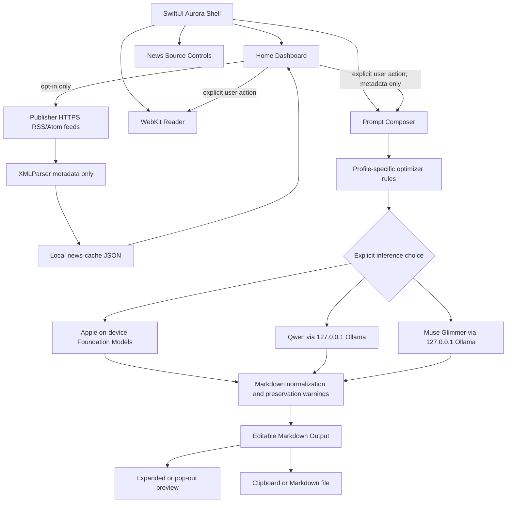

# HitFluence Prompt Optimizer — Local-First Architecture

## Data flow

## Runtime independence

The mini-app neither requires nor embeds HitTree or HitCode. Their repositories were inspected for design and developer-documentation guidance only. Models and their weights remain installed and managed outside this project. App displays actual local Ollama tags discovered at runtime.

## Security / privacy

1. User prompt data is handled only by the chosen local model provider; there is no provider auto-fallback.
2. News refresh is explicitly opt-in, uses built-in publisher feed URLs and caches short metadata. No external feed content is sent to the inference engine automatically.
3. Embedded WebKit uses a non-persistent data store, only allows HTTPS/about navigation, and has a separate pop-out window. It does not run downloaded JavaScript inside the app's Swift context.
4. Optional local prompt history is disabled until selected by the user. `.md` export goes only to the user-selected path.
5. No third-party SDKs, remote AI service keys or telemetry services are introduced.

## Conversation, versions and layout (Nov 17 workspace)

- **Core (`Sources/PromptStudioCore`, Foundation-only, unit tested):**
  - `PromptSession`: chat messages, artifact versions, and the submit → complete / fail / cancel lifecycle, plus accept, discard, restore and edit.
  - `GenerationRequest`: builds the data-enveloped model prompt and the instructions for initial and refinement turns.
  - `MarkdownDocument`: block parser.
  - `ArtifactDiff`: line diff.
  - `WorkspaceLayout`: panel rules and per-window persistence.
  - `ThumbnailCachePolicy`: validation, expiry and LRU eviction.
  - `NewsFeedParser` / `NewsSources`: moved here from the app so feed parsing is testable.
- **App:**
  - `StudioModel` runs only the selected engine and records results through the session API.
  - `SessionStore` persists sessions (opt-in) and migrates the old `history.json` once.
  - `ThumbnailCache` is an actor doing bounded, cancellable downloads.
  - `BrowserSession` is one private WebKit session per window.
- **Project generation:** `Documentation/create_project.py` includes every Swift file in `App/`, `App/Views`, `App/Services` and `Sources/PromptStudioCore`, and stops if a file is anywhere else. Icon rendering is opt-in (`--icons`).

## Platform status

Built and tested on macOS with Xcode 27.3 beta; see `BUILD_STATUS.md`. Signing with the owner's team, hands-on accessibility review and real screen captures remain open.
