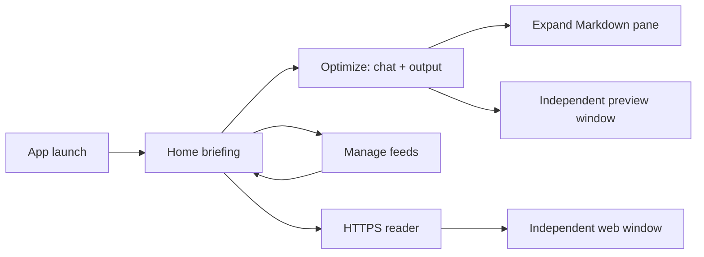

# HitFluence Prompt Optimizer — Aurora UI / UX Blueprint

## Goal

Preserve the user's established HitCode interface language in a focused standalone prompt-optimization mini-app. Launch on an editorial Home page; one action moves into two-pane prompt composition. Source browsing and Markdown output can expand independently without losing the drafted prompt.

## Navigation

## Information hierarchy

1. **Global shell:** slim brand lockup, local privacy state, contextual controls.
2. **Home:** striking `[#]` mascot lockup with Aurora glow, dated editorial heading, New Prompt action, source freshness and topic filters, one lead story plus related cards (when actual feed data exists), newsletter shortcuts.
3. **Optimize:** original prompt in a conversational pane, editable output side-by-side; optional expanded preview.
4. **Browser:** WebKit page fills the workspace, with address, back/forward/reload, in-window expand and pop-out. Browser state is ephemeral.
5. **Sources:** explicit news network consent, per-source switches, last fetch failures and refresh.

## Visual DNA

- Warm technical luxury: Ink/Navy base, cobalt/violet ambient lighting, gold accent on `[ # ]` mark.
- Use native system fonts; editorial serif only for feature headlines.
- Avoid a flat black window. Keep editor and browser reader backgrounds stable, with Aurora in chrome/hero.
- Sidebar 234pt; default window 1450×880; minimum 1020×690.
- One strong CTA per screen; not every card is a gradient.
- Clear disabled and offline states with actual explanations.

## Mascot asset

- Checked-in icon assets are a newly rendered 1024px bracketed-hashtag variant derived from HitFluence's established palette and brand direction.
- The user's exact approved original mascot image is not present in this repository. It must be reviewed and substituted rather than pretending a visual reconstruction is identical.
- The UI uses a scalable SwiftUI mark so there are no blurry small-size derivatives.

## Expansion matrix

| Surface | Default | Expanded | Pop-out |
|---|---|---|---|
| Markdown | Right of chat | Hides sidebar/chat to focus on output | Standalone window, shared prompt document |
| Web | Browser tab / workspace | Hides sidebar for more room | Standalone WebKit window using current selected URL |
| News | Editorial card | Original webpage in in-app browser | Browser pop-out, from browser window |

## Privacy / source fidelity

All headlines and metadata originate from publisher feed payloads. With feeds off and no cache, an opt-in empty state appears. Nothing is invented. Newsletter bookmarks open websites but are never scraped. News content is not sent to an AI model unless the user deliberately inserts it into the composer and runs optimization.

## Acceptance checks on owner's Mac

- Inspect Home at 1020×690 and 1450×880.
- Test sidebar routes, New Prompt, editor/output split, Expand, Pop Out, restoring pane and clipboard/export.
- Enable Home news, verify source failures, attribution, RSS/Atom date formatting and offline cache after relaunch.
- Verify that a story opens WebKit, address navigation works, HTTPS policy rejects non-web schemes, and Pop Out uses an independent reader.
- Verify with Reduce Motion and VoiceOver, check keyboard shortcuts and appropriate focus labels.
- Compare the new icon and mascot surface with the owner's approved HitFluence artwork before treating it as production brand parity.
