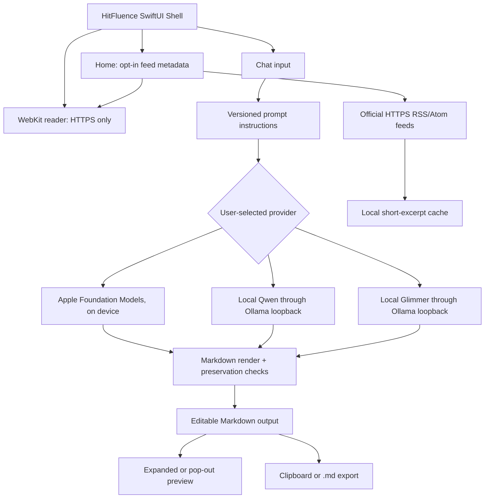

# HitFluence Prompt Optimizer

**Native Apple Silicon prompt-intelligence workspace** by HitFluence Media & Technology Group.

> **Status:** Source implementation. The Foundation-only optimizer core and RSS/Atom parser have been tested under Swift 6.2.1 on Linux. The macOS app must still be built, signed, and visually verified with Xcode 27.3 beta on the owner's Mac. This repository does not contain a compiled `.app`.

A private-by-default desktop workspace that turns a rough request into an agent-ready Markdown prompt without losing constraints. Its redesigned Aurora interface pairs a chat-style input area with an editable Markdown output area, a branded editorial Home briefing, and expandable preview and web-browser windows.

## UI experience

| Destination | Features |
|---|---|
| **Home** | HitFluence Aurora welcome, 1024px bracketed-hashtag icon, Start Prompt, opt-in publisher news, topic filters and curated newsletter shortcuts |
| **Optimize** | Chat/composer on the left, editable Markdown output on the right, provider/profile selectors, preservation warnings, Copy/Export |
| **Preview** | Expand Markdown within the main window or pop out into an independent large preview window |
| **Browser** | HTTPS-only WebKit reader with navigation, reload, address bar, external-open, expand and independent pop-out window |
| **Sources** | Toggle official feeds, enable/disable all network news, inspect fetch errors, and refresh on demand |
| **History** | On-device opt-in history with clear/delete actions; no implicit cloud synchronization |

The selected AI provider is always explicit:

- **Apple Foundation Models:** System on-device model when available (no external model download in the app).
- **Qwen Instruct:** Uses a user-installed local model exposed through Ollama on loopback (`127.0.0.1`). The model tag is discovered at runtime.
- **Muse Glimmer:** Uses a user-installed local Muse Glimmer model exposed through Ollama on loopback. No remote inference endpoint is configured.

A model that is unavailable reports an error; the application does not silently reroute prompts to another provider.

## Clone and open in Xcode

```bash
git clone https://github.com/dulayne-sys/HItFluence-PromptOptimizer.git
cd HItFluence-PromptOptimizer
open PromptStudio.xcodeproj
```

Select the **PromptStudio** scheme and **My Mac** target in **Xcode 27.3 beta**. Confirm a development team in Signing & Capabilities, then build and run. The project targets **macOS 27.0+** and uses Swift 6 strict concurrency checks. The included `Documentation/XCODE_MCP_HANDOFF.md` guides your connected Xcode agent through on-device verification.

To run the portable core tests:

```bash
swift test
```

The Python generator in `Documentation/create_project.py` can rebuild the native project file and original icon sizes when adding source files. **It is optional**; the checked-in `.xcodeproj` and assets are already generated. It requires Pillow if run. Never run the generator on a working Xcode project with uncommitted manual `project.pbxproj` changes.

## System architecture



No website content is automatically copied into a model prompt. Selecting **Use as prompt context** adds only the publisher, headline and URL to the user's editable composer; the user must explicitly optimize.

## Trusted news sources

The built-in source list was adapted from the owner's **HitCode** repository (`Sources/HitCode/News/NewsSources.swift`), not invented. Sources include Apple Developer, Swift.org, WebKit, Apple Machine Learning Research, Google DeepMind, Hugging Face, GitHub Blog, GitHub Security, and optional OpenAI/GitHub Changelog feeds.

**Superhuman AI** (`superhuman.ai`) and **The Code** (`codenewsletter.ai`) are publisher bookmarks on Home, not assumed machine-readable RSS feeds. The app does not scrape their newsletters. All news requests are off by default; enabling news requests only fetches the checked feeds. Publisher metadata is attributed, deduplicated, locally cached, and linked to the original article.

Feed availability can change; in-app source error messages reflect the result of the current user's refresh. The sources have not been reverified live from this environment. See `Documentation/NEWS_SOURCES.md`.

## Brand system

Uses the approved HitFluence palette and HitCode's Aurora surface guidance:

- **Ink** `#04050C` · **Navy** `#0B1236` · **Blue** `#2F6BFF`
- **Periwinkle** `#8FA8FF` · **Lavender** `#C9B8FF` · **Violet** `#9C7BFF`
- **Mint** `#3FE0B5` · **Coral** `#FF7A59` · **Gold** `#F2B33D`

A new scalable `[#]` SwiftUI mark and 1024px metallic-gold app-icon rendering provide immediate working assets. They are original vector-style interpretations of the specified brand direction, **not** a claim that the owner's approved original mascot image was recovered. Drop the approved production mascot artwork into the asset workflow when available, and preserve the established brand identity.

## Layout and source organization

```text
App/
  Brand.swift                  Aurora tokens, hashtag emblem, mascot hero
  StudioModel.swift            Navigation, active provider, state & actions
  PromptStudioApp.swift        Main, Preview, Browser and Menu Bar scenes
  Views/
    StudioRootView.swift       Navigation shell
    StudioSidebar.swift        Destination/model/history navigation
    HomeDashboard.swift        Editorial news + Continue Building
    NewsSourcesView.swift      Publisher source controls
    PromptChatPanel.swift      Prompt composer
    PromptOutputPanel.swift    Markdown output
    ExpandedOutputView.swift   Expandable / pop-out preview
    BrowserWorkspace.swift    Embedded & pop-out WebKit browser
  Services/
    NewsSources.swift          Publisher definitions and models
    NewsFeedParser.swift       RSS/Atom metadata parser
    NewsStore.swift            Network consent, refresh, cache
    AppleModelClient.swift     On-device model bridge
    LocalOllamaClient.swift    Loopback-only local model bridge
    HistoryStore.swift         Opt-in local persistence
    MacActions.swift           Clipboard and export
Sources/PromptStudioCore/       Pure Swift prompt rules and validation
Tests/PromptStudioCoreTests/   Portable core tests
Documentation/                 Build status, architecture, design and handoff
PromptStudio.xcodeproj/        Native macOS project + shared scheme
```

## Engineering and privacy boundaries

- Native SwiftUI, AppKit and WebKit. No Electron, Tauri, React, downloaded UI fonts, or third-party hosted model endpoint.
- News network requests are opt-in and separate from inference traffic.
- WebKit uses a non-persistent data store. Browser navigation permits HTTPS only.
- Input/history remains local unless the user explicitly copies or exports it.
- No remote app telemetry, authentication service, analytics SDK or silent cloud model fallback.
- Preservation checks are advisory, **not proof** that an optimized prompt is perfect.
- News cards show only real parsed source items, never fabricated news, dates or editorial imagery masquerading as live content.

## Validation and next gate

**Verified here:** 7/7 Swift package tests; RSS and Atom parser fixture smoke tests; Swift syntax parsing of app sources; regenerated Xcode project and XML plist inspection.

**Pending on macOS:** Xcode 27.3 beta compile, SDK symbol checks with HitTree, actual local provider discovery, WebKit integration interaction, signed app launch, keyboard/VoiceOver QA and responsive screenshots.

The project's final native build is intentionally delegated to the owner's Mac-side Xcode agent. See `Documentation/XCODE_VERIFICATION.md` for precise acceptance criteria.

## Provenance

The design direction was informed by the owner's private HitCode repo's `HITCODE_BRAND_KIT.md`, `HITCODE_UI_UX_REDESIGN.md` and `NewsSources.swift`, with the project kept completely standalone. No HitCode/HitTree binary or runtime dependency is required.

**Copyright © HitFluence Media & Technology Group.** No open-source license is assigned to this repository by this document.